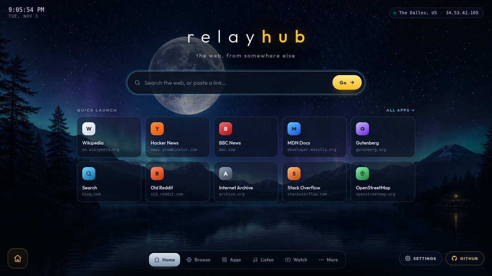
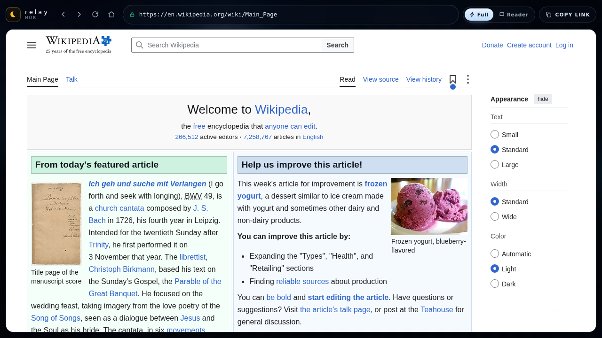
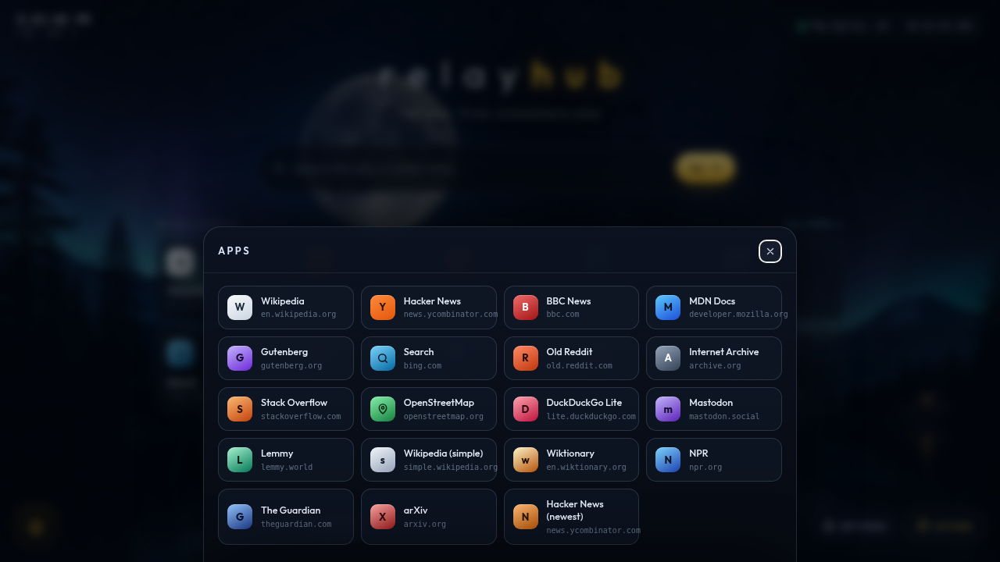

# Relay Hub

**A self-hosted web proxy with a launcher-style home screen.**

Night-sky hub with a search bar, pinned sites and an app grid — plus a real browser view that
fetches pages on the server and rewrites them so links, images, styles, scripts and forms all
keep working through the proxy.

Zero runtime dependencies. Node.js 18+.



---

## Features

### The proxy engine

- **Full URL rewriting** — `href`, `src`, `srcset`, `imagesrcset`, `poster`, `action`,
  `formaction`, `data`, `cite`, `background`, `xlink:href`, `ping`, `data-*` lazy-load
  attributes, inline `style`, `<style>` blocks, external CSS `url()` / `@import`,
  `<meta refresh>`, `<base href>` and `srcdoc` iframes — recursively.
- **A runtime shim inside every page** that patches `fetch`, `XMLHttpRequest`, `WebSocket`,
  `EventSource`, `navigator.sendBeacon` and `history.pushState`/`replaceState`. This is what
  makes single-page apps and client-side routing work instead of quietly falling over.
- **WebSocket proxying** — live sites, chat and streaming UIs keep their sockets.
- **Per-visitor cookie jar** on the server, implementing RFC 6265 domain/path matching,
  `Secure`, `Max-Age`/`Expires`, and host-only cookies. Two visitors never share a login.
- **Charset detection** (header → `<meta>` → UTF-8) so legacy pages render correctly.
- **Transparent decompression** of gzip/deflate/brotli, with re-compression negotiated per client.
- **Streaming rewrite** for very large documents, so a 50 MB page is still fully rewritten
  instead of being dumped through untouched.
- **Redirects stay inside the proxy** and are rewritten, never leaked as raw upstream URLs.
- **Reader mode** — scripts and inline handlers stripped, typography applied, content preserved.
- **Click-tracking unwrapping** (Bing `/ck/a`, DuckDuckGo `/l/`, Google `/url`) so result links
  point at the real destination.
- Response caching, ETags and 304 revalidation.

### The interface

**Hub** (`/`)
- Cinematic home screen: drifting night backdrop, live clock, exit-node badge (click it for
  proxy stats)
- Search bar that takes a URL *or* plain words, with eight switchable engines
- "Jump back in" — recent sites, stored in your browser only
- Quick-launch tiles, an app drawer with live filtering, and a settings sheet
- Keyboard first: `/` search, `Ctrl+K` apps, `Esc` close

**Browser** (`/browse`)
- Tabbed browsing with per-tab history and session restore
- Address bar that follows in-page navigation, back / forward / reload / hub
- **Full** mode (site JavaScript on) and **Reader** mode (scripts stripped)
- Find in page (`Ctrl+F`), shareable links, status bar with load timing
- `Ctrl+L` address bar, `Ctrl+T`/`Ctrl+W` tabs, `Ctrl+R` reload, `Alt+←/→` history



<p align="center"></p>

---

## Quick start

```bash
git clone https://github.com/<you>/relay-hub.git
cd relay-hub
node server.js
# → http://localhost:3000
```

No `npm install` — there are no dependencies.

### Docker

```bash
docker build -t relay-hub .
docker run -p 3000:3000 -e RELAY_PASS=something-long relay-hub
```

### Deploy

| Host | How |
| --- | --- |
| **Fly.io** | `fly launch --copy-config --now` (uses `fly.toml`) |
| **Render** | New → Blueprint → point at the repo (uses `render.yaml`) |
| **Railway** | New project → Deploy from repo (uses `railway.json`) |
| **Any VPS** | `docker compose up -d` (uses `docker-compose.yml`) |

---

## Configuration

Everything is optional and read from the environment at boot.

| Variable | Default | What it does |
| --- | --- | --- |
| `PORT` | `3000` | Port to listen on |
| `HOST` | `0.0.0.0` | Interface to bind |
| `RELAY_USER` | `relay` | Username when auth is enabled |
| `RELAY_PASS` | *(empty)* | **Set this to require HTTP basic auth.** Empty = open |
| `RELAY_REPO_URL` | *(empty)* | Shows a GitHub button in the hub |
| `RELAY_TIMEOUT` | `30000` | Upstream timeout, ms |
| `RELAY_MAX_HTML` | `12582912` | Largest document we buffer & rewrite (bytes) |
| `RELAY_MAX_BODY` | `16777216` | Largest request body we forward |
| `RELAY_MAX_STREAM` | `536870912` | Cap on a single streamed resource |
| `RELAY_CACHE_TTL` | `60` | Response cache TTL in seconds (`0` disables) |
| `RELAY_CACHE_MAX` | `67108864` | Cache size cap in bytes |
| `RELAY_RATE_LIMIT` | `0` | Requests/minute per IP (`0` = off) |
| `RELAY_ENGINE` | `duckduckgo` | Default search engine |
| `RELAY_LOG` | on | `0` silences request logs |
| `RELAY_LOG_LEVEL` | `info` | `silent` \| `error` \| `warn` \| `info` \| `debug` |
| `RELAY_ALLOW_PRIVATE` | `0` | `1` allows proxying LAN/private addresses (see below) |
| `RELAY_ISOLATE` | `0` | `1` marks proxied responses as `Cross-Origin-Resource-Policy: same-origin` |
| `RELAY_TRUST_PROXY` | `1` | Trust `X-Forwarded-For` for rate limiting and logs |
| `RELAY_INJECT` | *(empty)* | HTML snippet appended to every proxied page |
| `RELAY_STRICT_TLS` | `0` | `1` trusts only Node's CA bundle (no system store) |
| `RELAY_INSECURE_TLS` | `0` | `1` skips upstream certificate verification (**testing only**) |

```bash
RELAY_PASS='something-long' RELAY_REPO_URL='https://github.com/you/relay-hub' node server.js
```

> **Deploying publicly?** Set `RELAY_PASS`, and put TLS in front. Fly/Render/Railway do this for
> you; on a VPS use Caddy or a Cloudflare Tunnel.

---

## Endpoints

```
GET  /                        hub (launcher)
GET  /browse?url=<url>[&m=1]  browser view (m=1 → Reader mode)
GET  /p/<b64url>/<path>       path-style proxied page (what links use)
GET  /fetch?url=<url>[&m=1]   proxied + rewritten page (bookmarkable)
GET  /raw?url=<url>           proxied stream, no rewriting (images, files, media)
ANY  /form/<b64url(url)>      form submissions (POST bodies relayed intact)
GET  /ws?url=<ws url>         WebSocket upgrade
GET  /api/config              version, repo URL, auth flags, feature list
GET  /api/ip                  exit node: IP, city, country, ISP, latency
GET  /api/stats               uptime, requests, cache, cookies, memory
GET  /api/engines             available search engines
GET  /api/cookies?origin=…    inspect this session's cookie jar
DEL  /api/cookies             sign out of every proxied site
GET  /healthz                 liveness probe → "ok"
GET  /assets/*                theme, wallpaper, icons
```

`/fetch?url=…` is a normal link — bookmark it or send it to someone.

---

## Security model

A rewriting proxy fetches *any* public URL on request, which makes SSRF the main risk. Relay's
defences:

- **Literal-address blocking** in every notation: dotted, shortened (`127.1`), hex
  (`0x7f000001`), octal, decimal (`2130706433`), and IPv6 including `::1`, `::ffff:127.0.0.1`
  and `64:ff9b::/96` NAT64 embeddings.
- **DNS resolution is done by us, not the HTTP client**, and every resolved address is checked.
  A hostname that resolves to a private address is refused *at connect time*, which closes the
  DNS-rebinding hole a URL-level check leaves open.
- **Every redirect hop is re-validated** — a public URL cannot bounce you to `169.254.169.254`.
- **Cloud metadata** (`169.254.169.254`, `metadata.google.internal`) is explicitly denied.
- **Reserved names** — `.local`, `.internal`, `.localhost`, `.lan`, `.home`, `.test`, `.invalid`,
  `.onion` — are refused.
- **Loop protection** — the proxy will not fetch itself.
- **Non-standard ports** are refused by default, so it can't be used as a port scanner.
- **Per-visitor cookie isolation** — the jar is keyed by a session cookie, so one visitor's
  login is never replayed for another.
- **Cookie scope is enforced** — a `Domain` attribute that doesn't domain-match the request is
  dropped entirely, per RFC 6265 (this prevents `Domain=com` and similar escapes).
- **Basic auth** is compared with `timingSafeEqual`, with lockout after repeated failures.
- **Rate limiting** is available for public instances.
- Request bodies, response sizes, redirect depth and timeouts are all capped.
- Error pages never echo unescaped HTML or stack traces.

> **Known limitation, inherent to rewriting proxies:** proxied pages are served from the
> proxy's origin, so a hostile page could in principle read proxy-issued cookies. Don't log into
> sensitive accounts through a public instance you don't control. Run Relay for people you trust.

### Allowing private addresses

Set `RELAY_ALLOW_PRIVATE=1` if you want Relay to reach LAN services (a home router, a dev
server, an intranet wiki). This **disables the SSRF guard** — only do it on an instance that is
not exposed to the public internet.

---

## Known limits

These are inherent to any HTML-rewriting proxy, not bugs:

- **Sites that fingerprint or block datacenter IPs** (Google, YouTube, most banks, some
  Cloudflare-protected sites) will show captchas or refuse to load. Wikipedia, news sites, docs,
  Hacker News, Gutenberg, GitHub and DuckDuckGo HTML generally work.
- **JavaScript challenges** (Cloudflare "checking your browser") can't complete in Reader mode,
  and often struggle in Full mode because the challenge inspects the page origin.
- **Request signing** — sites that sign requests with a secret bound to the origin hostname will
  fail, because the hostname the browser sees is the proxy's.
- **`document.domain` tricks and strict COOP/COEP sites** may not work.
- Very large media streams are capped by `RELAY_MAX_STREAM`.

---

## Tests

```bash
npm test              # unit + security + integration (74 tests)
npm run test:security # SSRF, DNS rebinding, cookie isolation
npm run test:integration
```

The integration suite boots Relay against a local origin server and exercises every route —
no external network needed.

---

## Project layout

```
server.js              routing, sessions, auth, statics, API
src/url.js             URL mapping, base64url, SSRF validation, IP parsing
src/upstream.js        HTTP client: DNS pinning, redirects, cookies, trust store
src/cookies.js         per-session cookie jar (RFC 6265)
src/headers.js         response-header policy (CSP/HSTS/hop-by-hop stripping)
src/rewrite/html.js    HTML + CSS rewriting and the in-page runtime
src/cache.js           LRU response cache
src/net.js             compression and stream helpers
public/                hub, browser, theme, wallpaper
test/                  unit, security, integration
```

## License

MIT — see [LICENSE](LICENSE).
